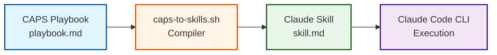

# Overview: CAPS-to-Skills Compiler

## What It Does

The CAPS-to-Skills compiler transforms CAPS (Claude Automated Playbook System) playbooks into Claude Code CLI Skills format. It automates the conversion process, validates playbook structure, and generates ready-to-use skill files that integrate seamlessly with Claude Code CLI.

Think of it as a translator: you write structured automation instructions in CAPS format (easy to author and version control), and the compiler converts them into the format Claude Code CLI expects (skill.md files).

## Compilation Flow

**Flow**: Author playbook → Compile to skill → Execute with Claude → Automate your workflow

## Key Capabilities

| Capability | Description | Benefit |
|------------|-------------|---------|
| **Validation** | Checks YAML frontmatter, required sections, code block matching | Catches errors before compilation |
| **Transformation** | Converts CAPS format to skill.md format with metadata preservation | Ensures compatibility with Claude CLI |
| **Automation** | Batch compile multiple playbooks, integrate with CI/CD | Saves time, enables workflow automation |
| **Logging** | Detailed output with color-coded messages (INFO, SUCCESS, ERROR, WARNING) | Easy debugging and troubleshooting |
| **Safety** | Dry-run mode previews changes without writing files | Test before committing |
| **Recovery** | Clear error messages with suggested fixes | Self-service problem resolution |

## Why Use the Compiler?

**Manual Conversion Problems**:
- ❌ Error-prone (easy to miss required fields or sections)
- ❌ Time-consuming (formatting, metadata management)
- ❌ Inconsistent output (varies by author)
- ❌ No validation (errors discovered at runtime)

**Compiler Benefits**:
- ✅ Guaranteed structure compliance
- ✅ Instant compilation (seconds per playbook)
- ✅ Consistent output format
- ✅ Pre-flight validation catches issues early

## Quick Start

Ready to compile your first playbook? See [Quick Start Guide](04-quickstart.md) for a 15-minute walkthrough from installation to first successful compilation.

**Prerequisites**: bash 4.0+, Unix-like environment (Linux/macOS/WSL)

**Next Steps**:
- Understand the architecture: [Compiler Architecture](02-architecture.md)
- Get it running: [Installation](03-installation.md)
- First compilation: [Quick Start](04-quickstart.md)

---

**Version**: 1.0.0 | **Compiler Version**: 2.0.0 | **Last Updated**: 2025-12-20
