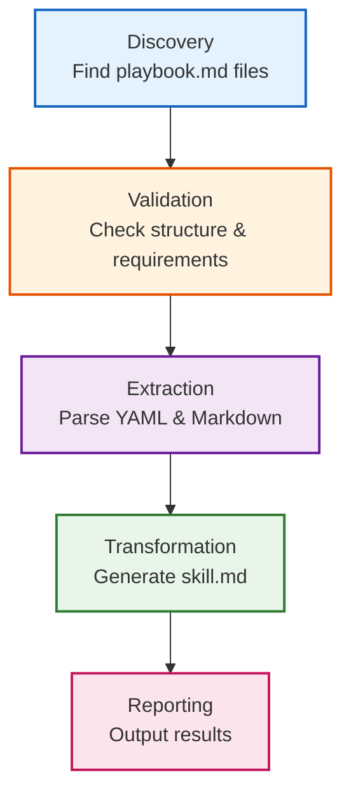

# Compiler Architecture

## 5-Stage Processing Pipeline

The CAPS-to-Skills compiler processes playbooks through five distinct stages, each with specific responsibilities and validations:



### Stage 1: Discovery

**Purpose**: Locate CAPS playbook files in the project structure

**Behavior**:
- Expects playbooks at: `caps-library/playbooks/<playbook-name>/playbook.md`
- Takes playbook name as CLI argument (NOT file path)
- Auto-detects project root from script location
- Skill name derived directly from directory name (no slugification)

**Example**:
```bash
./caps-to-skills.sh hello-world
# Looks for: caps-library/playbooks/hello-world/playbook.md
# Creates skill: .claude/skills/hello-world/skill.md
```

**Error**: `[ERROR] Playbook file not found: <path>`
- Check directory structure matches expected pattern
- Verify playbook name matches directory name

---

### Stage 2: Validation

**Purpose**: Ensure playbook meets structural and content requirements

**Validation Checks** (when `--validate` flag used):

#### 2.1 YAML Frontmatter Structure
- Must start with `---` on line 1
- Must end with `---` after metadata
- Content between markers must be valid YAML

**Blocks compilation if**: Unmatched `---` markers or invalid YAML syntax

#### 2.2 Required YAML Fields (5 total)

| Field | Type | Format | Example |
|-------|------|--------|---------|
| `title` | string | Display name | "Deploy Docker Container" |
| `description` | string | Brief explanation | "Deploy a containerized application" |
| `version` | string | Semver (MAJOR.MINOR.PATCH) | "1.0.0" |
| `allowed_tools` | array | List of tool names | `- docker`<br>`- bash` |
| `prerequisites` | array | List of requirements | `- docker_installed` |

**Blocks compilation if**: Any field missing or version format invalid

#### 2.3 Required Markdown Sections (4 total)

| Section | Purpose | Must Include |
|---------|---------|--------------|
| `## Prerequisites` | System requirements | Bullet list of prerequisites |
| `## Instructions` | Step-by-step workflow | At least one `### Step N` subsection |
| `## Validation` | Success criteria | Checklist or validation commands |
| `## Troubleshooting` | Common issues | Problem/solution pairs |

**Blocks compilation if**: Any section missing

#### 2.4 Code Block Matching
- Counts ` ``` ` markers in document
- Must be even number (every opening marker has closing marker)

**Blocks compilation if**: Unmatched code blocks (odd count)

#### 2.5 Quality Warnings (Non-Blocking)

| Warning | Trigger | Recommendation |
|---------|---------|----------------|
| Potential hardcoded secret | Keywords: password, apikey, token, secret | Use environment variables or .env files |
| Non-consecutive step numbering | Step 1 → Step 3 (skipped 2) | Renumber steps sequentially |
| Unknown tool | Tool not in whitelist | Add to whitelist or verify tool name |

**Known Tools Whitelist**: bash, kubectl, helm, docker, git, python, npm, curl, jq, yq, terraform, ansible, minikube, kind, make, cargo, rustc, go, node, ruby, pip, apt, yum, dnf, brew

---

### Stage 3: Extraction

**Purpose**: Parse YAML metadata and Markdown content from playbook

**Metadata Extraction**:
- Uses bash native tools (grep, sed) - no external dependencies
- Extracts: `title`, `description`, `version`
- Fallback values if fields missing:
  - title → directory name
  - description → "CAPS playbook: <name>"
  - version → "1.0.0"

**Content Extraction**:
- Content starts after second `---` marker (end of YAML frontmatter)
- First H1 (`# <title>`) removed (replaced with skill title in output)
- All other Markdown preserved exactly (code blocks, formatting, lists, tables)

**Example Extraction**:
```yaml
# Input YAML
title: Deploy Docker Container
description: Deploy a containerized application using Docker
version: 1.0.0

# Extracted Metadata
TITLE="Deploy Docker Container"
DESCRIPTION="Deploy a containerized application using Docker"
VERSION="1.0.0"
```

---

### Stage 4: Transformation

**Purpose**: Generate Claude Skill format (skill.md) from extracted data

**Skill Name Generation**:
- **Uses directory name as-is** (NO slugification, NO title-based naming)
- Example: `hello-world` directory → `hello-world` skill
- Example: `kafka-k8s-setup` directory → `kafka-k8s-setup` skill

**SKILL.md File Structure**:
```markdown
---
description: <from playbook>
version: <from playbook>
---

# <Title from playbook>

<Description from playbook>

<Verbatim content from playbook (minus first H1)>

---

**Source Playbook:** `caps-library/playbooks/<name>/playbook.md`
**Compiled:** <UTC timestamp>
**CAPS Version:** <version>
**Skill Name:** <name>
```

**Content Formatting Rules**:
- YAML frontmatter simplified: only `description` and `version` fields
- `allowed_tools` and `prerequisites` NOT included in skill output
- All Markdown sections copied verbatim:
  - Prerequisites (content preserved)
  - Instructions (all steps with code blocks)
  - Validation (checklists preserved)
  - Troubleshooting (problem/solution pairs)
- Metadata footer appended with compilation timestamp

---

### Stage 5: Reporting

**Purpose**: Output compilation results and next steps

**Success Output**:
```
[INFO] CAPS to Claude Skills Compiler v2.0.0
[INFO] ======================================
[INFO] Playbook: hello-world
[INFO] Source: /path/to/playbook.md
[INFO] Output: /path/to/skill.md

[INFO] Created output directory: .claude/skills/hello-world
[INFO] Reading CAPS playbook...
[INFO] Skill Name: hello-world (from directory)
[INFO] Title: Hello World Example
[INFO] Description: Simple example playbook
[INFO] Version: 1.0.0
[INFO] Generating Claude Skill...
[SUCCESS] Skill compiled successfully!
[SUCCESS] Output: .claude/skills/hello-world/skill.md

[INFO] Next steps:
[INFO] 1. Review the generated skill: cat .claude/skills/hello-world/skill.md
[INFO] 2. Test with Claude Code CLI
[INFO] 3. Refine CAPS playbook if needed
[INFO] 4. Commit both playbook and skill to git
```

**Failure Output**:
- Exits with code 1
- Clear error message with context
- Suggested fix (when applicable)

**Example Failure**:
```
[ERROR] Missing required field: version
```

---

## Transformation Rules Table

| CAPS Element | Transformation | SKILL.md Result |
|--------------|----------------|-----------------|
| `title` | → | H1 heading (`# <title>`) |
| `description` | → | YAML frontmatter + paragraph after H1 |
| `version` | → | YAML frontmatter |
| `allowed_tools` | ❌ | Not included (removed) |
| `prerequisites` | ❌ | Not included (removed) |
| `## Prerequisites` | ✓ | Copied verbatim |
| `## Instructions` | ✓ | Copied verbatim (all steps) |
| `## Validation` | ✓ | Copied verbatim |
| `## Troubleshooting` | ✓ | Copied verbatim |
| Code blocks | ✓ | Preserved exactly (language identifiers, comments) |
| Metadata footer | + | Added with timestamp, source path, skill name |

---

## Example Transformation

### Input: CAPS Playbook

See complete example: [sample-playbook.md](assets/examples/sample-playbook.md)

**Key sections**:
- YAML frontmatter with 5 required fields
- 4 required Markdown sections
- Code blocks with bash commands
- Validation checklist
- Troubleshooting section

### Output: Claude Skill

See corresponding output: [sample-skill.md](assets/examples/sample-skill.md)

**Transformation highlights**:
- ✅ Simplified YAML (description + version only)
- ✅ H1 title preserved
- ✅ All instructions copied verbatim
- ✅ Code blocks intact with comments
- ✅ Metadata footer added

### Side-by-Side Comparison

| Aspect | CAPS Playbook | Claude Skill |
|--------|---------------|--------------|
| **YAML Fields** | 5 fields (title, description, version, allowed_tools, prerequisites) | 2 fields (description, version) |
| **Content** | Prerequisites, Instructions, Validation, Troubleshooting | Identical sections copied verbatim |
| **Code Blocks** | Bash commands with comments | Preserved exactly |
| **Metadata** | None | Footer with source path, timestamp, skill name |
| **File Size** | ~1.2 KB | ~1.4 KB (added metadata footer) |

---

## Next Steps

- **Install the compiler**: [Installation Guide](03-installation.md)
- **Compile your first playbook**: [Quick Start](04-quickstart.md)
- **Understand all command options**: [Command Reference](05-command-reference.md)

---

**Version**: 1.0.0 | **Compiler Version**: 2.0.0 | **Last Updated**: 2025-12-20
