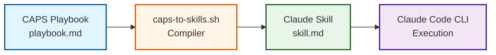
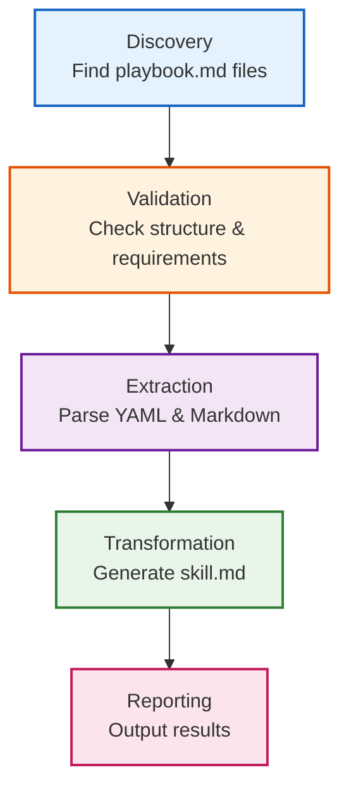

# CAPS-to-Skills Compiler Guide

**Version**: 1.0.0 | **Compiler Version**: 2.0.0 | **Last Updated**: 2025-12-20

Complete guide for the CAPS-to-Skills compiler - transform CAPS playbooks into Claude Code CLI Skills format with automated validation and compilation.

---

## Table of Contents

### Getting Started
1. [Overview](#1-overview)
   - [What It Does](#what-it-does)
   - [Compilation Flow](#compilation-flow)
   - [Key Capabilities](#key-capabilities)
   - [Why Use the Compiler](#why-use-the-compiler)

2. [Compiler Architecture](#2-compiler-architecture)
   - [5-Stage Processing Pipeline](#5-stage-processing-pipeline)
   - [Transformation Rules](#transformation-rules-table)
   - [Example Transformation](#example-transformation)

3. [Installation](#3-installation)
   - [Prerequisites](#prerequisites)
   - [Step-by-Step Setup](#step-by-step-setup)
   - [Troubleshooting Installation](#troubleshooting-installation)

4. [Quick Start Guide](#4-quick-start-guide)
   - [3-Minute Setup Workflow](#3-minute-setup-workflow)
   - [Using Generated Skills](#using-generated-skills)
   - [Success Checklist](#success-checklist)

### Reference
5. [Command Reference](#5-command-reference)
   - [Basic Syntax](#basic-syntax)
   - [Command Options](#command-options)
   - [Combining Options](#combining-options)

6. [Workflow Integration](#6-workflow-integration)
   - [Git Pre-Commit Hook](#git-pre-commit-hook)
   - [GitHub Actions CI/CD](#github-actions-cicd)
   - [Makefile Integration](#makefile-integration)

### Support
7. [Troubleshooting Guide](#7-troubleshooting-guide)
   - [Quick Diagnostics](#quick-diagnostics)
   - [Common Issues](#common-issues)
   - [Getting Help](#getting-help)

8. [Advanced Usage](#8-advanced-usage)
   - [Selective Compilation](#selective-compilation)
   - [Batch Processing](#batch-processing)
   - [Output Analysis](#output-analysis)

---

## 1. Overview

### What It Does

The CAPS-to-Skills compiler transforms CAPS (Claude Automated Playbook System) playbooks into Claude Code CLI Skills format. It automates the conversion process, validates playbook structure, and generates ready-to-use skill files that integrate seamlessly with Claude Code CLI.

Think of it as a translator: you write structured automation instructions in CAPS format (easy to author and version control), and the compiler converts them into the format Claude Code CLI expects (skill.md files).

### Compilation Flow



**Flow**: Author playbook → Compile to skill → Execute with Claude → Automate your workflow

### Key Capabilities

| Capability | Description | Benefit |
|------------|-------------|---------|
| **Validation** | Checks YAML frontmatter, required sections, code block matching | Catches errors before compilation |
| **Transformation** | Converts CAPS format to skill.md format with metadata preservation | Ensures compatibility with Claude CLI |
| **Automation** | Batch compile multiple playbooks, integrate with CI/CD | Saves time, enables workflow automation |
| **Logging** | Detailed output with color-coded messages (INFO, SUCCESS, ERROR, WARNING) | Easy debugging and troubleshooting |
| **Safety** | Dry-run mode previews changes without writing files | Test before committing |
| **Recovery** | Clear error messages with suggested fixes | Self-service problem resolution |

### Why Use the Compiler?

**Manual Conversion Problems**:
- ❌ Error-prone (easy to miss required fields or sections)
- ❌ Time-consuming (formatting, metadata management)
- ❌ Inconsistent output (varies by author)
- ❌ No validation (errors discovered at runtime)

**Compiler Benefits**:
- ✅ Guaranteed structure compliance
- ✅ Instant compilation (seconds per playbook)
- ✅ Consistent output format
- ✅ Pre-flight validation catches issues early

---

## 2. Compiler Architecture

### 5-Stage Processing Pipeline



#### Stage 1: Discovery
- Locates playbooks at: `caps-library/playbooks/<playbook-name>/playbook.md`
- Takes playbook name as CLI argument
- Skill name derived from directory name (no slugification)

#### Stage 2: Validation
- **YAML frontmatter**: Must have matched `---` markers
- **5 required fields**: title, description, version (semver), allowed_tools, prerequisites
- **4 required sections**: Prerequisites, Instructions, Validation, Troubleshooting
- **Code block matching**: Even number of ` ``` ` markers

#### Stage 3: Extraction
- Parses YAML metadata using bash native tools (grep/sed)
- Extracts content after second `---` marker
- Preserves all Markdown formatting

#### Stage 4: Transformation
- Simplifies YAML frontmatter (description + version only)
- Copies all content verbatim (minus first H1)
- Appends metadata footer with timestamp

#### Stage 5: Reporting
- Color-coded output (INFO/SUCCESS/ERROR/WARNING)
- Clear error messages with suggested fixes
- Next steps guidance

### Transformation Rules Table

| CAPS Element | Transformation | SKILL.md Result |
|--------------|----------------|-----------------|
| `title` | → | H1 heading (`# <title>`) |
| `description` | → | YAML frontmatter + paragraph |
| `version` | → | YAML frontmatter |
| `allowed_tools` | ❌ | Not included (removed) |
| `prerequisites` | ❌ | Not included (removed) |
| `## Prerequisites` | ✓ | Copied verbatim |
| `## Instructions` | ✓ | Copied verbatim |
| `## Validation` | ✓ | Copied verbatim |
| `## Troubleshooting` | ✓ | Copied verbatim |
| Code blocks | ✓ | Preserved exactly |
| Metadata footer | + | Added with timestamp |

### Example Transformation

**Input**: [sample-playbook.md](assets/examples/sample-playbook.md)
**Output**: [sample-skill.md](assets/examples/sample-skill.md)

For detailed architecture documentation, see [02-architecture.md](02-architecture.md).

---

## 3. Installation

### Prerequisites

**System Requirements**:
- **bash** 4.0+
- **find, grep, sed, awk** (GNU versions)
- **Operating System**: Linux, macOS, Windows (WSL/Git Bash)

**Verify Prerequisites**:
```bash
bash --version
which find grep sed awk
```

### Step-by-Step Setup

#### Step 1: Locate Compiler Script
```bash
ls -la caps-library/scripts/caps-to-skills.sh
```

#### Step 2: Make Executable
```bash
chmod +x caps-library/scripts/caps-to-skills.sh
```

#### Step 3: Verify Directory Structure
```
project-root/
├── caps-library/
│   ├── scripts/
│   │   └── caps-to-skills.sh
│   └── playbooks/
│       └── <playbook-name>/
│           └── playbook.md
└── .claude/
    └── skills/
```

```bash
mkdir -p caps-library/playbooks
mkdir -p .claude/skills
```

#### Step 4: Test Installation
```bash
bash caps-library/scripts/caps-to-skills.sh --help
```

For complete installation instructions and troubleshooting, see [03-installation.md](03-installation.md).

---

## 4. Quick Start Guide

### 3-Minute Setup Workflow

#### Step 1: Verify Compiler (30 seconds)
```bash
bash caps-library/scripts/caps-to-skills.sh --help
```

#### Step 2: Validate Playbook (1 minute)
```bash
bash caps-library/scripts/caps-to-skills.sh <playbook-name> --validate --dry-run
```

#### Step 3: Compile Playbook (30 seconds)
```bash
bash caps-library/scripts/caps-to-skills.sh <playbook-name> --validate
```

#### Step 4: Verify Output (1 minute)
```bash
cat .claude/skills/<playbook-name>/skill.md
```

### Using Generated Skills

```bash
# List available skills
ls .claude/skills/

# Run with Claude Code CLI
claude --skill <skill-name>
```

### Success Checklist

After completing quick start:
- ✅ Run compiler help successfully
- ✅ Validate existing playbooks
- ✅ Compile playbooks to skills
- ✅ Verify generated skill.md files
- ✅ Execute skills with Claude CLI

**Total Time**: ~15 minutes from installation to execution

For complete quick start guide, see [04-quickstart.md](04-quickstart.md).

---

## 5. Command Reference

### Basic Syntax

```bash
caps-to-skills.sh <playbook-name> [OPTIONS]
```

### Command Options

| Option | Short | Description | Use Case |
|--------|-------|-------------|----------|
| `--help` | `-h` | Show usage information | First time using, quick reference |
| `--validate` | `-v` | Run validation checks | Before compilation, in CI/CD |
| `--dry-run` | N/A | Preview without writing | Test compilation path |
| `--output DIR` | `-o` | Custom output directory | Multi-environment, testing |

### Combining Options

```bash
# Validate without compiling
bash caps-to-skills.sh <name> --validate --dry-run

# Validate and compile to custom directory
bash caps-to-skills.sh <name> --validate -o ./custom-skills/

# All options together
bash caps-to-skills.sh <name> --validate -o /tmp/test --dry-run
```

For complete command reference, see [05-command-reference.md](05-command-reference.md).

---

## 6. Workflow Integration

### Git Pre-Commit Hook

Automatically validate and compile playbooks before commits.

**Installation**:
```bash
cp caps-library/docs/compiler-guide/assets/examples/pre-commit .git/hooks/pre-commit
chmod +x .git/hooks/pre-commit
```

**Features**:
- Validates only modified playbooks
- Blocks commits on validation failure
- Stages generated skills automatically

**Example**: [pre-commit](assets/examples/pre-commit)

### GitHub Actions CI/CD

Automate compilation in GitHub workflows.

**Setup**:
```bash
mkdir -p .github/workflows
cp caps-library/docs/compiler-guide/assets/examples/caps-compile.yml .github/workflows/
```

**Features**:
- Triggers on playbook changes
- Validates on pull requests
- Compiles and commits on push

**Example**: [caps-compile.yml](assets/examples/caps-compile.yml)

### Makefile Integration

Local development automation.

**Installation**:
```bash
cp caps-library/docs/compiler-guide/assets/examples/Makefile Makefile
```

**Targets**:
- `make validate`: Validate all playbooks
- `make compile`: Compile all playbooks
- `make clean`: Remove generated skills
- `make all`: Full rebuild

**Example**: [Makefile](assets/examples/Makefile)

For complete integration guide, see [06-workflow-integration.md](06-workflow-integration.md).

---

## 7. Troubleshooting Guide

### Quick Diagnostics

```bash
# 1. Verify compiler
ls -la caps-library/scripts/caps-to-skills.sh

# 2. Test help
bash caps-library/scripts/caps-to-skills.sh --help

# 3. Check bash version
bash --version

# 4. Validate playbook
bash caps-library/scripts/caps-to-skills.sh <name> --validate --dry-run
```

### Common Issues

| Issue | Symptom | Solution |
|-------|---------|----------|
| **Playbook not found** | `[ERROR] Playbook file not found` | Verify directory structure |
| **Invalid YAML** | `[ERROR] Invalid YAML frontmatter` | Check `---` markers |
| **Missing field** | `[ERROR] Missing required field` | Add all 5 required fields |
| **Invalid version** | `[ERROR] Invalid version format` | Use semver (X.Y.Z) |
| **Missing section** | `[ERROR] Missing required section` | Add all 4 required sections |
| **Unmatched blocks** | `[ERROR] Unmatched code block markers` | Match all ` ``` ` markers |

For detailed troubleshooting, see [07-troubleshooting.md](07-troubleshooting.md).

---

## 8. Advanced Usage

### Selective Compilation

```bash
# Compile by pattern
for dir in caps-library/playbooks/kubernetes-*/; do
    playbook=$(basename "$dir")
    bash caps-library/scripts/caps-to-skills.sh "$playbook" --validate
done

# Compile recently modified (last 24 hours)
find caps-library/playbooks/ -name "playbook.md" -mtime -1 -type f | while read playbook_path; do
    playbook_name=$(dirname "$playbook_path" | xargs basename)
    bash caps-library/scripts/caps-to-skills.sh "$playbook_name" --validate
done
```

### Batch Processing

**Script**: [compile-all-libraries.sh](assets/examples/compile-all-libraries.sh)

```bash
# Compile all playbooks
bash caps-library/docs/compiler-guide/assets/examples/compile-all-libraries.sh

# Compile to custom directory
bash caps-library/docs/compiler-guide/assets/examples/compile-all-libraries.sh /opt/skills
```

### Output Analysis

**Script**: [list-skills.sh](assets/examples/list-skills.sh)

```bash
# List all compiled skills with metadata
bash caps-library/docs/compiler-guide/assets/examples/list-skills.sh

# Count skills
ls .claude/skills/*/skill.md 2>/dev/null | wc -l
```

For advanced patterns, see [08-advanced-usage.md](08-advanced-usage.md).

---

## Next Steps

### Learn More
- **Architecture Deep Dive**: [Compiler Architecture](02-architecture.md)
- **All Command Options**: [Command Reference](05-command-reference.md)
- **Automate Everything**: [Workflow Integration](06-workflow-integration.md)
- **Power User Techniques**: [Advanced Usage](08-advanced-usage.md)

### Need Help?
- **Common Problems**: [Troubleshooting Guide](07-troubleshooting.md)
- **Installation Issues**: [Installation Troubleshooting](03-installation.md#troubleshooting-installation)
- **Report Bugs**: [Project Repository Issues](../../)

### Write Playbooks
**CAPS Format Requirements**:
1. YAML frontmatter with 5 fields (title, description, version, allowed_tools, prerequisites)
2. 4 Markdown sections (Prerequisites, Instructions, Validation, Troubleshooting)
3. Matched code blocks (even number of ` ``` ` markers)
4. Semver version numbering (MAJOR.MINOR.PATCH)

**Template**: See [test-playbook.md](assets/examples/test-playbook.md)

---

## Document Metadata

**Version**: 1.0.0
**Compiler Version**: 2.0.0
**Last Updated**: 2025-12-20
**Compatibility**: bash 4.0+, Linux/macOS/WSL

**Documentation Structure**:
- 8 section files (01-08)
- Master README (this file)
- 9 example files (scripts, workflows, configs)
- 2 Mermaid diagrams (compilation flow, pipeline stages)
- 3 sample playbooks/skills

**Total Word Count**: ~12,000 words
**Estimated Reading Time**: 45-60 minutes (full guide)
**Quick Start Time**: 15 minutes (MVP path)

---

## License

This documentation is part of the CAPS library project. See project LICENSE for details.

---

**🎯 Ready to get started?** Jump to [Installation](03-installation.md) or [Quick Start](04-quickstart.md)!
