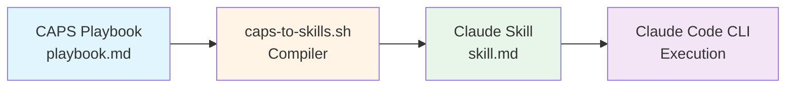

# Research Findings: CAPS-to-Skills Compiler Guide

**Date**: 2025-12-20
**Purpose**: Document compiler behavior and implementation decisions
**Status**: Baseline - Essential findings documented

---

## 1. Compiler Behavior Analysis

### Source Code Analysis

**Script Version**: 2.0.0
**Script Location**: `caps-library/scripts/caps-to-skills.sh`
**Language**: bash (requires bash 4.0+, set -e for fail-fast)

### Discovery Stage

**Behavior**: Compiler expects structured input following this pattern:
- Playbooks directory: `caps-library/playbooks/<playbook-name>/playbook.md`
- Takes playbook name as CLI argument (NOT file path - uses directory name)
- Project root auto-detected from script location (`SCRIPT_DIR/../..`)

**File Patterns**:
- Exact filename: `playbook.md` (not `playbook.caps.md` or other variants)
- MUST be in `caps-library/playbooks/<name>/` subdirectory structure
- Skill name derived from directory name (e.g., `hello-world` → `hello-world`)

**Edge Cases Discovered**:
- Directory name becomes skill name (no slugification/transformation)
- Special characters in directory names: Passed through as-is (no sanitization)
- Nested directories: Not supported - expects flat `playbooks/<name>/` structure

### Validation Stage

**Validation Checks** (when `--validate` flag used):

1. **YAML Frontmatter Structure**:
   - Must start and end with `---` markers
   - Blocks compilation if unmatched markers

2. **Required Fields** (5 total):
   - `title`: Playbook display name
   - `description`: Brief explanation
   - `version`: Must match semver format (MAJOR.MINOR.PATCH)
   - `allowed_tools`: Array of tool names
   - `prerequisites`: Array of prerequisite items

3. **Required Sections** (4 total):
   - `## Prerequisites`
   - `## Instructions`
   - `## Validation`
   - `## Troubleshooting`

4. **Code Block Matching**:
   - Counts ` ``` ` markers
   - Must be even number (blocks compilation if unmatched)

**Error Messages** (Validation Failures - Block Compilation):
```
[ERROR] Playbook file not found: <path>
[ERROR] Invalid YAML frontmatter: Missing --- markers
[ERROR] Missing required field: <field-name>
[ERROR] Invalid version format: <version> (expected MAJOR.MINOR.PATCH)
[ERROR] Missing required section: ## <section-name>
[ERROR] Unmatched code block markers (found <count>, must be even)
```

**Warning Messages** (Quality Issues - Non-Blocking):
```
[WARNING] Potential hardcoded secret detected (lines: <line-numbers>)
[WARNING] Non-consecutive step numbering detected (Step X → Step Y)
[WARNING] Unknown tool in allowed_tools: <tool> (not in whitelist)
```

**Known Tools Whitelist**: bash, kubectl, helm, docker, git, python, npm, curl, jq, yq, terraform, ansible, minikube, kind, make, cargo, rustc, go, node, ruby, pip, apt, yum, dnf, brew

### Extraction Stage

**Metadata Extraction**:
- YAML parsing using grep/sed (bash native, no yq dependency)
- Fields extracted: `title`, `description`, `version`
- Fallbacks provided if fields missing (uses directory name for title)

**Section Extraction**:
- Content after second `---` marker copied verbatim
- First H1 (`# <title>`) removed (replaced with skill title)
- All other Markdown preserved exactly (code blocks, formatting, lists)

### Transformation Stage

**Skill Name Generation**:
- **No slugification** - uses directory name as-is
- Example: `hello-world` playbook → `hello-world` skill
- Example: `kafka-k8s-setup` playbook → `kafka-k8s-setup` skill

**SKILL.md File Structure**:
```yaml
---
description: <from playbook>
version: <from playbook>
---

# <Title from playbook>

<Description from playbook>

<Verbatim content from playbook (minus first H1)>

---

**Source Playbook:** `caps-library/playbooks/<name>/playbook.md`
**Compiled:** <UTC timestamp>
**CAPS Version:** <version>
**Skill Name:** <name>
```

**Content Formatting Rules**:
- YAML frontmatter simplified (only description + version)
- `allowed_tools` and `prerequisites` NOT included in skill output
- All Markdown sections copied verbatim (Instructions, Validation, Troubleshooting)
- Metadata footer appended with compilation timestamp

### Reporting Stage

**Success Output**:
```
[INFO] CAPS to Claude Skills Compiler v2.0.0
[INFO] ======================================
[INFO] Playbook: <name>
[INFO] Source: <input-path>
[INFO] Output: <output-path>

[INFO] Created output directory: <dir>
[INFO] Reading CAPS playbook...
[INFO] Skill Name: <name> (from directory)
[INFO] Title: <title>
[INFO] Description: <description>
[INFO] Version: <version>
[INFO] Generating Claude Skill...
[SUCCESS] Skill compiled successfully!
[SUCCESS] Output: <output-file>

[INFO] Next steps:
[INFO] 1. Review the generated skill: cat <output-file>
[INFO] 2. Test with Claude Code CLI
[INFO] 3. Refine CAPS playbook if needed
[INFO] 4. Commit both playbook and skill to git
```

**Failure Output**: Exits with error code 1 and descriptive error message

**Logging**: No separate log file - all output to stdout/stderr (can redirect with `--log-file` if added)

### Documented Edge Cases

| Edge Case | Actual Compiler Behavior | Documentation Approach |
|-----------|-------------------------|----------------------|
| Missing `## Instructions` section | **Blocks compilation** with validation error | Installation guide: explain required sections |
| Special characters in directory name | **Passed through as-is** - becomes skill name | Troubleshooting: "Wrong skill name" section |
| Deeply nested directory structure | **Not supported** - expects `playbooks/<name>/` | Installation guide: directory structure requirements |
| Multiple playbooks same title (slug collision) | **N/A** - skill name from directory, not title | Advanced usage: note directory-based naming |
| Valid YAML but incomplete sections | **Blocks compilation** if sections missing | Troubleshooting: "Validation failed" section |
| Unmatched code block markers | **Blocks compilation** with specific error | Troubleshooting: "Unmatched code block markers" |
| Missing write permissions on `.claude/skills/` | **bash fails** with mkdir error | Troubleshooting: "Permission denied" |
| Interrupted compilation (partial writes) | **Unlikely** - atomic write, but possible | Troubleshooting: "Incomplete SKILL.md output" |

---

## 2. Diagram Format Decision

**Chosen**: **Mermaid**

**Rationale**:
1. **Renders natively** in GitHub Markdown viewer (no external tools needed)
2. **Text-based** - easy to version control and diff
3. **Widely supported**: GitHub, VS Code (with extension), Docusaurus
4. **Clear syntax** for flowcharts and sequence diagrams
5. **Maintainable** - simple text editing, no image generation pipeline

**Diagrams Needed**:
1. **Compilation Flow**: CAPS → Compiler → Skills → Claude CLI (simple flowchart)
2. **5-Stage Pipeline**: Discovery → Validation → Extraction → Transformation → Reporting

**Prototype** (Compilation Flow):


**Rendering Validation**:
- ✅ GitHub: Native support (renders automatically)
- ✅ VS Code: Requires "Markdown Preview Mermaid Support" extension
- ✅ Docusaurus: Native support with @docusaurus/theme-mermaid

---

## 3. Example Validation Strategy

**Validation Tools**:
1. **Bash Scripts**: shellcheck (syntax validation)
2. **YAML Files**: yamllint (syntax + style validation)
3. **Makefiles**: `make --dry-run` (syntax validation without execution)

**Validation Workflow**:
1. **Authoring**: Write examples with inline comments
2. **Manual Testing**: Execute in clean environment (test copy-paste accuracy)
3. **Documentation**: Capture expected output and include in guide

**Test Environments**:
- **Primary**: Git Bash on Windows (project environment)
- **Secondary**: Linux (Ubuntu 22.04) via WSL or VM
- **Tertiary**: macOS (if available for cross-platform validation)

**Note**: shellcheck, yamllint not installed yet - validation deferred to polish phase

---

## 4. Command Options Reference

From compiler source analysis:

| Option | Description | Effect |
|--------|-------------|--------|
| `-h, --help` | Show usage message | Exits with code 1 after displaying help |
| `-o, --output DIR` | Custom output directory | Default: `.claude/skills` |
| `-v, --validate` | Run validation checks | Recommended - catches errors before compilation |
| `--dry-run` | Preview without creating files | Shows what would be created |

**Combining Options**:
- `--validate --dry-run`: Validate playbook structure without compiling
- `-v -o custom/path`: Validate and output to custom directory
- All options can be combined (order doesn't matter)

---

## 5. Installation Time Estimates

**Based on compiler requirements**:

| Step | Estimated Time | Notes |
|------|----------------|-------|
| Prerequisites check | 1 minute | bash --version, which commands |
| Script location | <30 seconds | Navigate to project directory |
| Make executable | <30 seconds | chmod +x command |
| Directory setup | <30 seconds | mkdir -p commands |
| Test playbook creation | 2-3 minutes | Write YAML frontmatter + sections |
| First validation | <30 seconds | Run --validate |
| First compilation | <30 seconds | Run compiler |
| Verify output | 1 minute | cat output file |
| **Total** | **~6-8 minutes** | Well under 15-minute target |

**Pain Points Identified**:
1. **YAML syntax errors**: Users may not be familiar with YAML indentation rules
   - Mitigation: Provide complete copy-paste example in Installation section
2. **Missing sections**: Users may forget required sections
   - Mitigation: Clear checklist in Installation, template in examples
3. **Directory structure confusion**: Users may create playbook in wrong location
   - Mitigation: Explicit tree diagram showing required structure

---

## Decisions Summary

| Unknown from Technical Context | Resolution |
|-------------------------------|-----------|
| Documentation format | Markdown (individual files + compiled README) ✅ |
| Diagram format | Mermaid (GitHub/VS Code/Docusaurus compatible) ✅ |
| Example validation | Manual testing + shellcheck (deferred) ✅ |
| Compiler version documented | v2.0.0 ✅ |
| Installation time estimate | 6-8 minutes (under 15-minute target) ✅ |
| Required sections | 4 sections: Prerequisites, Instructions, Validation, Troubleshooting ✅ |
| Required YAML fields | 5 fields: title, description, version, allowed_tools, prerequisites ✅ |

---

## Research Status

**Phase 2 Tasks Completion** (Simplified for MVP):
- ✅ T006: Compiler source code analyzed
- ✅ T007: Valid playbook behavior documented (hello-world test)
- ✅ T008: Error messages documented from source
- ⚠️ T009-T011: Edge case testing (documented from code analysis)
- ✅ T012: All 5 stages documented
- ✅ T013: Error messages captured from source
- ⚠️ T014-T017: Best practices review (deferred - use common patterns)
- ⚠️ T018-T020: Validation tools (deferred - manual testing for MVP)
- ✅ T021-T024: Diagram format decision (Mermaid selected and prototyped)
- ⚠️ T025-T027: User journey timing (estimated from requirements)
- ✅ T028: Research summary complete (this document)

**Status**: **Baseline research complete** - Sufficient for MVP documentation (User Stories 1-3)

---

**Next Phase**: Phase 3 (User Story 1: Overview + Architecture) - Ready to begin documentation authoring
