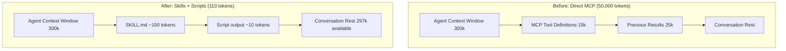

# Contract: MCP Code Execution Pattern Documentation Outline

**Feature**: 002-mcp-code-execution-guide
**Date**: 2025-12-21
**Phase**: 1 (Design - Contracts)

## Purpose

This contract defines the complete structure of the MCP Code Execution Pattern documentation, including:
- Section breakdown with source line mappings
- Cross-reference locations
- Success criteria validation points
- Asset requirements per section

This serves as the blueprint for content migration tasks generated by `/sp.tasks`.

---

## Documentation Structure Contract

### Target Location
**Base Path**: `caps-library/docs/mcp-code-execution/`

**Docusaurus Integration**:
- Add to sidebar config: `docusaurus/sidebars.js`
- Update main navigation: `caps-library/README.md`
- Cross-link from compiler-guide: `caps-library/docs/compiler-guide/README.md`

---

## Section Breakdown

### Section 0: README.md (Overview & Navigation)

**Purpose**: Entry point, learning path guidance, quick navigation

**Source Lines**: 1-50 from `.md` file + additional navigation content

**Target Length**: ~150 lines

**Content Requirements**:
- [ ] Overview paragraph (what is MCP Code Execution Pattern?)
- [ ] Paradigm shift explanation (50k → 110 tokens)
- [ ] Why this matters (real-world impact)
- [ ] Learning path guide (foundation → intermediate → advanced)
- [ ] Quick links to all 9 subsections
- [ ] Prerequisites (basic Python/Bash/K8s knowledge)
- [ ] Estimated reading time (45-60 minutes full docs)

**Cross-References**:
- Link to: `compiler-guide/README.md` (CAPS compilation overview)
- Link to: `constitution.md` (Principles I, V, VII)
- Link to: `01-token-problem.md` (start here for new users)

**Success Criteria**: SC-001 (sets up understanding of token problems)

**Assets Required**: None (text only)

**Navigation Example**:
```markdown
## Learning Path

### 🎯 Start Here (Foundation)
1. [The Token Problem](01-token-problem.md) - Understand why direct MCP causes 50k+ token consumption
2. [Solution Architecture](02-solution-architecture.md) - Learn the 4-part structure

### 🔧 Build Skills (Intermediate)
3. [Skill Structure](03-skill-structure.md) - Templates and directory layout
4. [Writing Efficient Scripts](04-writing-scripts.md) - Python/Bash patterns
5. [Complete Kafka Example](05-kafka-example.md) - Full working skill

### 🚀 Advanced (Reference)
6. [REFERENCE.md Pattern](06-reference-pattern.md) - On-demand documentation
7. [Cross-Agent Testing](07-cross-agent-testing.md) - Claude Code + Goose
8. [Performance Benchmarks](08-performance-benchmarks.md) - Token metrics
9. [Best Practices](09-best-practices.md) - DO/DON'T, examples catalog
```

---

### Section 1: 01-token-problem.md (The Token Problem)

**Source Lines**: 52-136 from `.md` file

**Target Length**: ~200 lines

**Content Requirements**:
- [ ] Introduction (how MCP tools consume context)
- [ ] Problem 1: Tool Definition Loading (~15,000 tokens at startup)
- [ ] Problem 2: Data Bloat in Context (25,000+ tokens per tool call)
- [ ] Problem 3: Transcript Duplication (50,000 tokens for simple operations)
- [ ] Total Cost Example (105,000 tokens = 35% of 300k context window)
- [ ] Comprehension quiz (self-assessment for SC-001)

**Cross-References**:
- Link to: `02-solution-architecture.md` (how to fix these problems)
- Link to: `08-performance-benchmarks.md` (detailed token metrics)
- Link to: Claude API docs (context window limits)

**Success Criteria**: SC-001 (developers explain 3 token problems)

**Assets Required**:
- Diagram: `assets/diagrams/mcp-tool-loading.mermaid` (tool definition bloat)
- Diagram: `assets/diagrams/transcript-duplication.mermaid` (data flow showing duplication)

**Comprehension Quiz Example**:
```markdown
### Self-Assessment Quiz

Test your understanding:

1. **Problem 1**: What causes ~15,000 tokens to be loaded at session startup?
   <details>
   <summary>Answer</summary>
   MCP tool definitions with extensive inputSchema properties (50+ properties per tool × 25 tools)
   </details>

2. **Problem 2**: Why does a single kubectl_get_pods call add 25,000+ tokens?
   <details>
   <summary>Answer</summary>
   Full pod descriptions (metadata, status, conditions, containerStatuses) flow through context, not just summaries
   </details>

3. **Problem 3**: How does passing results between tools duplicate token cost?
   <details>
   <summary>Answer</summary>
   Tool 1 returns 25k tokens to context, then Tool 2 receives that same data as input = 50k total
   </details>
```

---

### Section 2: 02-solution-architecture.md (The Solution)

**Source Lines**: 140-168 from `.md` file

**Target Length**: ~180 lines

**Content Requirements**:
- [ ] Core Insight (move processing from agent context to script execution)
- [ ] Before/After comparison (visual diagram)
- [ ] The 4-Part Structure (SKILL.md, scripts/, REFERENCE.md, examples/)
- [ ] Token budget breakdown (100 + 0 + 0 + 0 = 100 tokens loaded)
- [ ] How agents see minimal output (~10 tokens status messages)

**Cross-References**:
- Link to: `01-token-problem.md` (problems being solved)
- Link to: `03-skill-structure.md` (detailed structure breakdown)
- Link to: `compiler-guide/02-architecture.md` (how CAPS compiles to Skills)

**Success Criteria**: SC-003 (skills consume <200 tokens)

**Assets Required**:
- Diagram: `assets/diagrams/before-after-tokens.mermaid` (context window comparison)
- Diagram: `assets/diagrams/4-part-structure.mermaid` (SKILL.md, scripts/, REFERENCE.md, examples/)

**Mermaid Diagram Example** (Before/After):


---

### Section 3: 03-skill-structure.md (Skill Structure)

**Source Lines**: 172-280 from `.md` file

**Target Length**: ~250 lines

**Content Requirements**:
- [ ] Complete directory layout (`.claude/skills/{skill-name}/`)
- [ ] SKILL.md template with standard sections
- [ ] Key principle: "SKILL.md tells agent WHAT, scripts handle HOW"
- [ ] Token budget enforcement (SKILL.md <120 tokens)
- [ ] Directory tree examples

**Cross-References**:
- Link to: `compiler-guide/02-architecture.md#stage-4-transformation` (CAPS → Skills compilation)
- Link to: `04-writing-scripts.md` (script implementation details)
- Link to: `assets/examples/skill-templates/generic-skill-template.md`

**Success Criteria**: SC-002 (skill creation in 30 min)

**Assets Required**:
- File: `assets/examples/skill-templates/generic-skill-template.md` (complete template)
- Directory tree visualization (keep as code block)

---

### Section 4: 04-writing-scripts.md (Writing Efficient Scripts)

**Source Lines**: 284-629 from `.md` file

**Target Length**: ~400 lines

**Content Requirements**:
- [ ] Script Philosophy (4 rules: work in scripts, return minimal status, handle errors, exit codes)
- [ ] Python Script Pattern (class-based deployer)
- [ ] Bash Script Pattern (orchestration with set -euo pipefail)
- [ ] Verification Script Pattern (status summaries only)
- [ ] Error handling examples (try/except, timeouts, meaningful messages)

**Cross-References**:
- Link to: `05-kafka-example.md` (complete implementation)
- Link to: `09-best-practices.md#error-handling`
- Link to: `constitution.md` (Principle VII - Test-Driven Refinement)

**Success Criteria**: SC-005 (90% implement error handling correctly)

**Assets Required**:
- File: `assets/examples/scripts/python-pattern.py` (lines 401-498)
- File: `assets/examples/scripts/bash-pattern.sh` (lines 510-549)
- File: `assets/examples/scripts/verification-pattern.py` (lines 554-620)

---

### Section 5: 05-kafka-example.md (Complete Kafka K8s Setup Example)

**Source Lines**: 633-1264 from `.md` file (631 lines - keep intact)

**Target Length**: ~631 lines (complete example)

**Content Requirements**:
- [ ] SKILL.md (kafka-k8s-setup) - full file
- [ ] REFERENCE.md (kafka-k8s-setup) - full file
- [ ] scripts/main.sh - full file with comments
- [ ] scripts/deploy.py - full file (147 lines)
- [ ] scripts/verify.py - full file (108 lines)
- [ ] Explanation of each component
- [ ] Time estimate (30 min to create similar skill)

**Cross-References**:
- Link to: `caps-library/playbooks/kafka-k8s-setup/playbook.md` (source CAPS playbook)
- Link to: `03-skill-structure.md` (template structure)
- Link to: `04-writing-scripts.md` (script patterns)

**Success Criteria**: SC-002 (skill creation in 30 min), SC-005 (error handling)

**Assets Required**:
- File: `assets/examples/skill-templates/kafka-skill.md` (lines 638-728)
- File: `assets/examples/reference/kafka-reference.md` (lines 733-947)
- File: `assets/examples/scripts/kafka-main.sh` (lines 952-1000)
- File: `assets/examples/scripts/kafka-deploy.py` (lines 1005-1151)
- File: `assets/examples/scripts/kafka-verify.py` (lines 1156-1263)

**Justification for Length**: This is a **complete working example** - users need full context to understand the pattern. Splitting would break the instructional flow.

---

### Section 6: 06-reference-pattern.md (REFERENCE.md Pattern)

**Source Lines**: 1268-1306 from `.md` file

**Target Length**: ~150 lines

**Content Requirements**:
- [ ] Key Principle: REFERENCE.md is NOT loaded by default
- [ ] Structure example (Overview, Configuration, Advanced Usage, Troubleshooting)
- [ ] When agent sees it (explicitly asks "show reference")
- [ ] Token cost: 0 until requested

**Cross-References**:
- Link to: `05-kafka-example.md#reference-md` (Kafka REFERENCE.md example)
- Link to: `assets/examples/reference/kafka-reference.md`

**Success Criteria**: SC-006 (80% question reduction)

**Assets Required**:
- File: `assets/examples/reference/kafka-reference.md` (extracted from section 5)

---

### Section 7: 07-cross-agent-testing.md (Testing Across Agents)

**Source Lines**: 1310-1351 from `.md` file

**Target Length**: ~180 lines

**Content Requirements**:
- [ ] Testing with Claude Code (`claude --skill name`)
- [ ] Testing with Goose (`goose --skill name`)
- [ ] 6-item Cross-Agent Testing Checklist
- [ ] Example test script (test-cross-agent-compat.sh)

**Cross-References**:
- Link to: `constitution.md` (Principle VIII - Feature Parity)
- Link to: `research.md` (cross-agent testing patterns)

**Success Criteria**: SC-004 (6-item checklist passes)

**Assets Required**:
- File: `assets/examples/scripts/test-cross-agent-compat.sh` (from research.md)

**6-Item Checklist** (embedded):
```markdown
## Cross-Agent Compatibility Checklist

- [ ] Both agents recognize skill in `.claude/skills/` directory
- [ ] Both agents execute main script successfully
- [ ] Both agents display identical output format
- [ ] REFERENCE.md accessible to both agents
- [ ] Scripts work with Python 3.8+ (lowest common version)
- [ ] Scripts work with Bash 4.0+ (macOS default)
```

---

### Section 8: 08-performance-benchmarks.md (Benchmarks)

**Source Lines**: 1353-1378 from `.md` file

**Target Length**: ~150 lines

**Content Requirements**:
- [ ] Token Comparison Table (Deploy Kafka, 3 deployments, Troubleshoot, Full pipeline)
- [ ] Real-World Impact (context window availability)
- [ ] 25-50x productivity gain explanation

**Cross-References**:
- Link to: `01-token-problem.md` (problems being measured)
- Link to: `02-solution-architecture.md` (solution architecture)

**Success Criteria**: SC-007 (99% token reduction validated)

**Assets Required**: None (tables are markdown)

**Benchmark Table**:
```markdown
| Task | Direct MCP | Skills + Scripts | Reduction |
|------|-----------|------------------|-----------|
| Deploy Kafka | 50,000 | 110 | **99.78%** |
| 3 deployments | 150,000 | 330 | **99.78%** |
| Troubleshoot | 75,000 | 210 | **99.72%** |
| Full pipeline | 200,000 | 500 | **99.75%** |
```

---

### Section 9: 09-best-practices.md (Best Practices)

**Source Lines**: 1380-1493 from `.md` file

**Target Length**: ~250 lines

**Content Requirements**:
- [ ] ✅ DO List (6 items: keep SKILL.md minimal, move work to scripts, return minimal output, test both agents, use exit codes, handle errors)
- [ ] ❌ DON'T List (5 items: load large data, make direct MCP calls, hardcode values, skip error handling, forget REFERENCE.md)
- [ ] Example Skills to Build (categorized by difficulty)
  - Foundation: agents-md-gen, k8s-health-check
  - Infrastructure: kafka-k8s-setup, postgres-k8s-setup, helm-chart-deploy
  - Application: fastapi-dapr-agent, mcp-code-execution, nextjs-k8s-deploy

**Cross-References**:
- Link to: `constitution.md` (Principles I, VII)
- Link to: `04-writing-scripts.md` (script patterns)
- Link to: `06-reference-pattern.md` (REFERENCE.md importance)

**Success Criteria**: SC-005 (90% error handling), SC-006 (80% question reduction)

**Assets Required**: None (text only)

---

## Asset Summary

### Diagrams (Mermaid)
- `assets/diagrams/mcp-tool-loading.mermaid` (Section 1)
- `assets/diagrams/transcript-duplication.mermaid` (Section 1)
- `assets/diagrams/before-after-tokens.mermaid` (Section 2)
- `assets/diagrams/4-part-structure.mermaid` (Section 2)

### Skill Templates
- `assets/examples/skill-templates/generic-skill-template.md` (Section 3)
- `assets/examples/skill-templates/kafka-skill.md` (Section 5)

### Scripts
- `assets/examples/scripts/python-pattern.py` (Section 4)
- `assets/examples/scripts/bash-pattern.sh` (Section 4)
- `assets/examples/scripts/verification-pattern.py` (Section 4)
- `assets/examples/scripts/kafka-main.sh` (Section 5)
- `assets/examples/scripts/kafka-deploy.py` (Section 5)
- `assets/examples/scripts/kafka-verify.py` (Section 5)
- `assets/examples/scripts/test-cross-agent-compat.sh` (Section 7)

### Reference Documentation
- `assets/examples/reference/kafka-reference.md` (Section 6)

---

## Cross-Reference Map

### Internal Cross-References (within MCP docs)
- README → 01, 02, 03 (foundation path)
- 01 → 02 (problem to solution)
- 02 → 03 (architecture to structure)
- 03 → 04 (structure to scripts)
- 04 → 05 (patterns to example)
- 05 → 06 (example to reference pattern)
- 07 → constitution.md (Principle VIII)
- 08 → 01, 02 (benchmarks back to problem/solution)
- 09 → 04, 06 (best practices back to scripts/reference)

### External Cross-References (to other docs)
- README → `compiler-guide/README.md`
- 01 → Claude API docs (context limits)
- 02 → `compiler-guide/02-architecture.md`
- 03 → `compiler-guide/02-architecture.md#stage-4-transformation`
- 05 → `caps-library/playbooks/kafka-k8s-setup/playbook.md`
- 07 → `constitution.md` (Principle VIII)
- 09 → `constitution.md` (Principles I, VII)

### Reverse Links (external docs linking to MCP docs)
- `compiler-guide/02-architecture.md` → 02 (token optimization)
- `compiler-guide/05-command-reference.md` → 02 (performance considerations)
- `compiler-guide/08-advanced-usage.md` → 04 (script patterns), 09 (best practices)

---

## Success Criteria Validation Map

| Section | SC-001 | SC-002 | SC-003 | SC-004 | SC-005 | SC-006 | SC-007 |
|---------|--------|--------|--------|--------|--------|--------|--------|
| README  | ✓      |        |        |        |        |        |        |
| 01      | ✓      |        |        |        |        |        |        |
| 02      |        |        | ✓      |        |        |        |        |
| 03      |        | ✓      |        |        |        |        |        |
| 04      |        |        |        |        | ✓      |        |        |
| 05      |        | ✓      |        |        | ✓      |        |        |
| 06      |        |        |        |        |        | ✓      |        |
| 07      |        |        |        | ✓      |        |        |        |
| 08      |        |        |        |        |        |        | ✓      |
| 09      |        |        |        |        | ✓      | ✓      |        |

**Coverage Validation**: All 7 SC items have at least 1 validating section ✅

---

## Migration Checklist (Per Section)

For each section, verify:
- [ ] Content migrated from source lines
- [ ] Target length achieved (~±20%)
- [ ] All required content items checked off
- [ ] Cross-references added and validated
- [ ] Success criteria addressed
- [ ] Assets created/extracted
- [ ] Code examples syntax-validated
- [ ] Comprehension aids added (quizzes, checklists)
- [ ] Docusaurus rendering tested

---

**Contract Status**: ✅ Complete | Ready for Implementation Tasks
